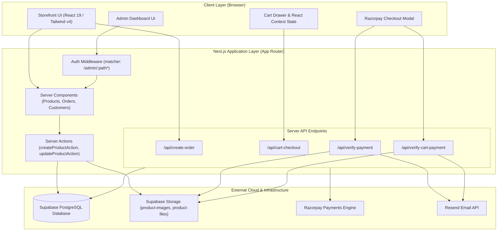
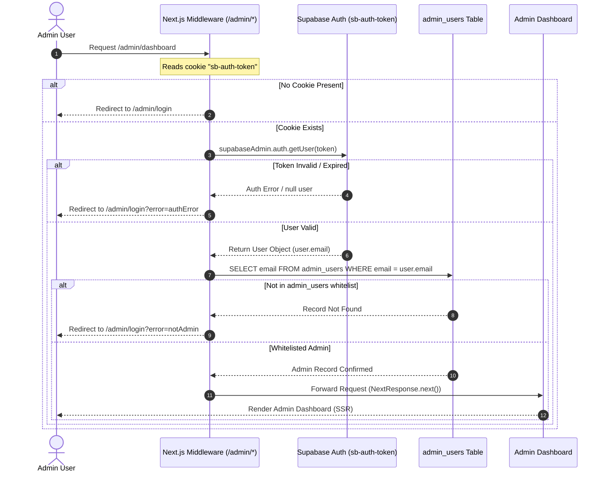
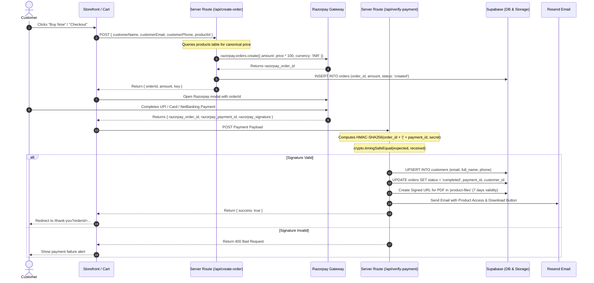
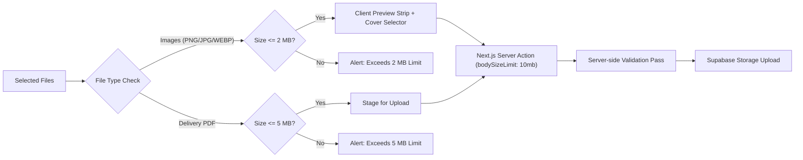

# System Architecture
Studio Maya - Modern Digital Product Store Architecture

> [!NOTE]
> This document details the production engineering architecture of **Studio Maya**, a high-performance digital commerce platform built on Next.js 16 (App Router), React 19, Supabase (PostgreSQL & Storage), Razorpay Payments, and Resend Transactional Email.

---

## 1. System Overview

Studio Maya provides a frictionless e-commerce experience for digital goods (such as Notion workspaces, study templates, and digital toolkits). It operates on a unified full-stack architecture combining edge-compatible React Server Components, secure server-side checkout validation, automated digital delivery pipelines, and a role-based administrative back-office.

---

## 2. Technology Stack

| Architectural Layer | Technology | Version / Spec | Purpose & Implementation Details |
| :--- | :--- | :--- | :--- |
| **Framework** | Next.js (App Router) | `16.3.8` | Server Components, dynamic streaming, routing, and route handlers |
| **Runtime & Core** | React | `19.2.8` | Component rendering, state primitives, actions, and server interactions |
| **Type System** | TypeScript | `^5.0` | Strict end-to-end type safety across clients, routes, and DB models |
| **Styling** | Tailwind CSS | `^4.0` | Utility-first responsive design, modern CSS variables, and layout system |
| **Database** | Supabase (PostgreSQL) | Managed Cloud | Relational tables for products, orders, customers, and administrators |
| **Asset Storage** | Supabase Storage | Object Storage | Public `product-images` bucket and private `product-files` delivery bucket |
| **Payment Gateway** | Razorpay SDK | `^2.9.8` | Secure payment capture, order tokens, and HMAC-SHA256 signature verification |
| **Transactional Email** | Resend SDK | `^6.32.0` | Immediate post-purchase delivery of signed PDF download links and receipts |
| **Icons & UI** | Lucide React | `^1.50.0` | Clean iconography across storefront, cart drawer, and admin panels |

---

## 3. Authentication & Administrative Security

Administrative routes (`/admin/*`) are strictly guarded using Next.js Edge Middleware and a two-stage verification handshake.

> [!IMPORTANT]
> The admin back-office leverages `createSupabaseAdminClient` initialized with `SUPABASE_SERVICE_ROLE_KEY`. This securely bypasses Row Level Security (RLS) on the server while keeping client keys strictly read-only or scoped.

---

## 4. End-to-End Checkout & Digital Delivery Flow

Studio Maya supports two checkout modes:
1. **Direct "Buy Now"**: Single-product purchase initiated from `/products/[id]`.
2. **Multi-Item Cart**: Multi-product purchase processed from the slide-out `CartDrawer` or `/cart-checkout`.

---

## 5. Database Schema & Relational Models

The relational schema is hosted on PostgreSQL via Supabase:

```mermaid
erDiagram
    CUSTOMERS ||--o{ ORDERS : "places"
    PRODUCTS ||--o{ ORDER_ITEMS : "included in"
    ORDERS ||--o{ ORDER_ITEMS : "contains"
    
    CUSTOMERS {
        uuid id PK
        text full_name
        text email UK
        text phone
        timestamptz created_at
        timestamptz updated_at
    }

    PRODUCTS {
        uuid id PK
        text name
        text short_description
        text description
        numeric price
        numeric original_price
        text category
        text status
        text image_url "Comma-separated URLs"
        text pdf_url "Storage file path"
        text template_url
        timestamptz created_at
    }

    ORDERS {
        uuid id PK
        text order_id UK "Razorpay Order ID"
        text payment_id "Razorpay Payment ID"
        numeric amount
        text status "'created' | 'completed' | 'failed'"
        uuid customer_id FK
        text customer_name
        text customer_email
        text customer_phone
        text product_name
        timestamptz created_at
    }

    ORDER_ITEMS {
        uuid id PK
        uuid order_id FK
        uuid product_id FK
        numeric price
        timestamptz created_at
    }

    ADMIN_USERS {
        uuid id PK
        text email UK
        timestamptz created_at
    }

    ADMIN_SETTINGS {
        uuid id PK
        text store_name
        text store_description
        text store_email
        text store_phone
        text currency
        timestamptz updated_at
    }
```

---

## 6. Digital Asset Pipeline & Upload Constraints

To maintain optimal load speeds, prevent Supabase storage quota exhaustion, and support varied visual assets without distorting or cropping:

### Key Constraints & Implementation Details:
1. **Server Action Envelope**: `next.config.ts` sets `experimental.serverActions.bodySizeLimit: '10mb'`, sufficient for a 5 MB PDF plus multiple 2 MB images in a single payload.
2. **Aspect Ratio Preservation**: The storefront gallery (`ProductGallery.tsx`) employs `object-contain` and `max-w-full max-h-full` within bounded responsive viewports (`h-[360px] sm:h-[420px] md:h-[480px]`). Portrait, landscape, and square graphics render without clipping or distortion.
3. **Signed Download Tokens**: Customer PDF links are generated with an expiration window of 7 days (`60 * 60 * 24 * 7` seconds) with `{ download: true }` flags.

---

## 7. Operational Environment Configuration

| Variable Key | Scope | Security Level | Purpose |
| :--- | :--- | :--- | :--- |
| `NEXT_PUBLIC_SUPABASE_URL` | Public Client / Server | Safe | Supabase project API gateway endpoint |
| `NEXT_PUBLIC_SUPABASE_ANON_KEY` | Public Client | Scoped | Anonymous client for public read queries |
| `SUPABASE_SERVICE_ROLE_KEY` | Server Only | Secret / High | Bypasses RLS for order writes and admin actions |
| `RAZORPAY_KEY_ID` | Client & Server | Public identifier | Initiates client checkout modal and server order tokens |
| `RAZORPAY_KEY_SECRET` | Server Only | Secret / High | Generates order tokens & verifies cryptographic HMAC |
| `EMAIL_PROVIDER_API_KEY` | Server Only | Secret / High | Authorizes Resend transactional email transmissions |
