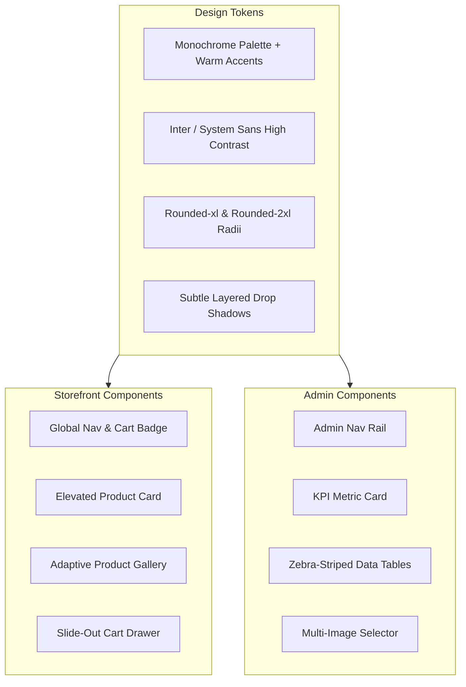
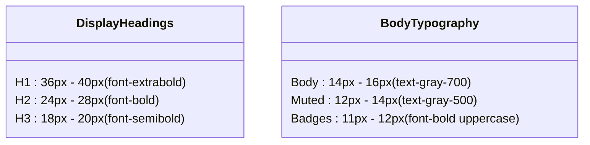
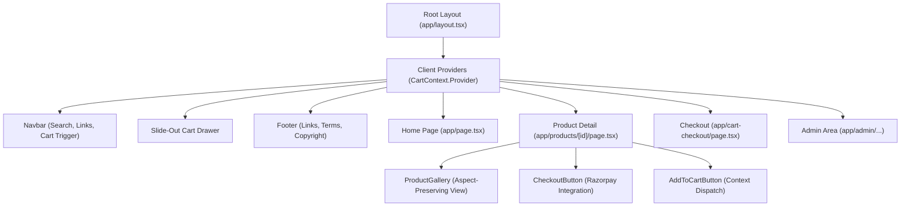

# Design System & UI Architecture
Studio Maya - Clean, Minimalist, Premium Commerce

> [!NOTE]
> Studio Maya follows a minimalist design language emphasizing content clarity, high-contrast typography, and smooth micro-interactions that elevate the perceived value of digital products.

---

## 1. Core Design Philosophy

- **Extreme Visual Clarity**: Distraction-free product presentation with generous whitespace and clear visual hierarchies.
- **Micro-Interactions**: Subtle elevation changes on card hovers (`hover:-translate-y-1`), fluid transitions for drawers and buttons, and tactile click feedback.
- **Distortion-Free Imagery**: Products are visual assets; images must never be squeezed, stretched, or awkwardly cropped regardless of original aspect ratios.

---

## 2. Color Palette & Token System

| Token Name | Hex Code | Tailwind Class | Semantic Application |
| :--- | :--- | :--- | :--- |
| **Primary Black** | `#000000` | `bg-black`, `text-black` | Primary CTA buttons, key headings, active thumbnails |
| **Pure White** | `#ffffff` | `bg-white` | Card backgrounds, main page canvas, clean containers |
| **Surface Gray** | `#f9fafb` | `bg-gray-50` | Storefront body backdrop, neutral gallery container |
| **Border Gray** | `#e5e7eb` | `border-gray-200` | Card borders, subtle divider lines, thumbnail frames |
| **Muted Text** | `#6b7280` | `text-gray-500` | Supporting descriptions, reviews count, timestamps |
| **Warm Accent** | `#ffedd5` / `#9a3412`| `bg-orange-100 text-orange-800` | Category badge pill across product cards & detail headers |
| **Star Rating** | `#facc15` | `text-yellow-400` | Customer rating stars |
| **Danger / Alert** | `#fee2e2` / `#b91c1c`| `bg-red-50 text-red-600` | Validation errors, payment failures, delete triggers |

---

## 3. Typography Hierarchy

- **Headings**: High contrast bold text (`font-bold`, `tracking-tight`).
- **Numbers & Pricing**: Prominent display (`text-2xl font-bold`) paired with strikethrough M.R.P. (`text-sm text-gray-400 line-through`).
- **Button Labels**: Medium to bold weight with `whitespace-nowrap` to prevent awkward line breaks on mobile devices.

---

## 4. Component Architecture & Hierarchy

---

## 5. Responsive Behavior & Micro-Animations

> [!TIP]
> All touch targets for mobile devices are sized to a minimum of 44x44 pixels to ensure effortless one-handed ordering on mobile browsers.

1. **Card Elevation**: `hover:-translate-y-1 hover:shadow-md transition-all duration-200` provides instantaneous responsiveness.
2. **Cart Drawer**: Slides smoothly from the right edge with a backdrop blur overlay (`bg-black/40 backdrop-blur-xs`).
3. **Adaptive Product Gallery**: Automatically switches between single-column stacked on mobile and two-column balanced layout on desktop viewports (`grid grid-cols-1 md:grid-cols-2 gap-16`).
