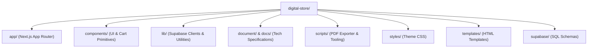

# Repository Structure & Module Architecture
Studio Maya - Digital Product Store

> [!NOTE]
> This document maps out the organizational structure, architectural boundaries, and purpose of every directory and key module within the Studio Maya codebase.

---

## 1. High-Level Directory Overview



---

## 2. Directory Tree & Key File Map

```text
digital-store/
├── app/                               # Next.js App Router (Pages, Layouts & API)
│   ├── layout.tsx                     # Global Root Layout (Injects Razorpay & Cart Provider)
│   ├── page.tsx                       # Public Storefront (Dynamic product catalog grid)
│   ├── globals.css                    # Global Tailwind CSS directives
│   ├── about/
│   │   └── page.tsx                   # Store policy, contact info, and legal terms
│   ├── cart-checkout/
│   │   └── page.tsx                   # Multi-item cart checkout form & payment trigger
│   ├── products/
│   │   └── [id]/
│   │       └── page.tsx               # Product detail page (Uses ProductGallery & CheckoutButton)
│   ├── thank-you/
│   │   └── page.tsx                   # Post-purchase order confirmation & status page
│   ├── api/                           # Server API Route Handlers
│   │   ├── create-order/
│   │   │   └── route.tsx              # Server-verified Razorpay order creation for Buy Now
│   │   ├── verify-payment/
│   │   │   └── route.tsx              # HMAC verification, customer upsert & Resend email delivery
│   │   ├── cart-checkout/
│   │   │   └── route.tsx              # Batch order creation for cart purchases
│   │   └── verify-cart-payment/
│   │       └── route.tsx              # Batch payment verification & multi-item email fulfillment
│   └── admin/                         # Protected Back-Office Panel
│       ├── layout.tsx                 # Admin layout with navigation sidebar
│       ├── login/
│       │   └── page.tsx               # Admin login screen (Email & Password via Supabase Auth)
│       ├── dashboard/
│       │   └── page.tsx               # Sales analytics, revenue charts & top products (SSR)
│       ├── products/
│       │   ├── page.tsx               # Products inventory list & management
│       │   ├── actions.ts             # Server Actions for creating/updating products
│       │   ├── new/
│       │   │   └── page.tsx           # Add Product form (Multi-image + PDF upload)
│       │   └── [id]/edit/
│       │       └── page.tsx           # Edit Product form (Re-order images, replace PDF)
│       ├── orders/
│       │   └── page.tsx               # Order history & transaction audit table (SSR)
│       ├── customers/
│       │   └── page.tsx               # Unique customer roster & lifetime purchase stats (SSR)
│       └── settings/
│           └── page.tsx               # Store configuration settings
├── components/                        # Reusable React UI Components
│   ├── Navbar.tsx                     # Global navigation header with cart trigger
│   ├── Footer.tsx                     # Global footer with brand statement
│   ├── CheckoutButton.tsx             # Direct "Buy Now" button triggering Razorpay modal
│   ├── AddToCartButton.tsx            # Adds product to global shopping cart state
│   ├── CartContext.tsx                # React Context for persistent cart state (localStorage)
│   ├── CartDrawer.tsx                 # Slide-out interactive shopping cart drawer
│   ├── ClientProviders.tsx            # Client boundary wrapper for CartContext
│   └── ProductGallery.tsx             # Aspect-preserving multi-image gallery & thumbnail strip
├── lib/                               # Core Utilities & Infrastructure Clients
│   ├── supabase.ts                    # Public client initialized with anon key
│   ├── supabaseAdmin.ts               # Privileged server client initialized with service role key
│   └── productUtils.ts                # Helpers for parsing multiple image URLs and cover image
├── scripts/                           # Build & Tooling Automation
│   └── export-pdf.mjs                 # Markdown-to-PDF compiler using Playwright & Mermaid
├── styles/                            # Technical Documentation Styles
│   └── theme.css                      # Reusable dark technical documentation theme
├── templates/                         # Document Templates
│   └── document.html                  # HTML template for PDF generation with Mermaid & Highlight.js
├── document/                          # Comprehensive Technical Documentation
│   ├── ARCHITECTURE.md                # System Architecture & Service Topology
│   ├── PRD.md                         # Product Requirements & Feature Specs
│   ├── DESIGN.md                      # Design System, Palette & Component Hierarchy
│   ├── FILE_STRUCTURE.md              # This Repository Structure Document
│   ├── RULES.md                       # Engineering Standards & Security Guidelines
│   └── TASKS.md                       # Development Roadmap & Implementation Log
├── supabase/                          # Database Schemas & Migrations
│   └── setup.sql                      # SQL definitions for customers, orders, and admin tables
├── middleware.ts                      # Edge middleware protecting /admin routes via cookies
├── next.config.ts                     # Next.js configuration (Server Action body size limits)
└── package.json                       # Dependencies and npm scripts
```

---

## 3. Module Responsibilities Matrix

| Module / Path | Execution Environment | Key Responsibility |
| :--- | :--- | :--- |
| `middleware.ts` | Edge Runtime | Intercepts `/admin/*` routes; validates `sb-auth-token` and checks `admin_users` table |
| `app/api/*` | Node.js Serverless | Verifies prices against Supabase DB, creates Razorpay orders, verifies HMAC signatures |
| `app/admin/products/actions.ts` | Next.js Server Actions | Processes multipart product uploads (image array, PDF) with size validation (2MB / 5MB) |
| `components/ProductGallery.tsx` | Browser Client | Renders product visuals using `object-contain` without distortion or cropping |
| `components/CartContext.tsx` | Browser Client | Manages active cart items, calculates totals, and persists state across page reloads |
| `scripts/export-pdf.mjs` | Local Node.js / Chromium | Renders Markdown with embedded Mermaid diagrams and outputs A4 PDF documentation |
