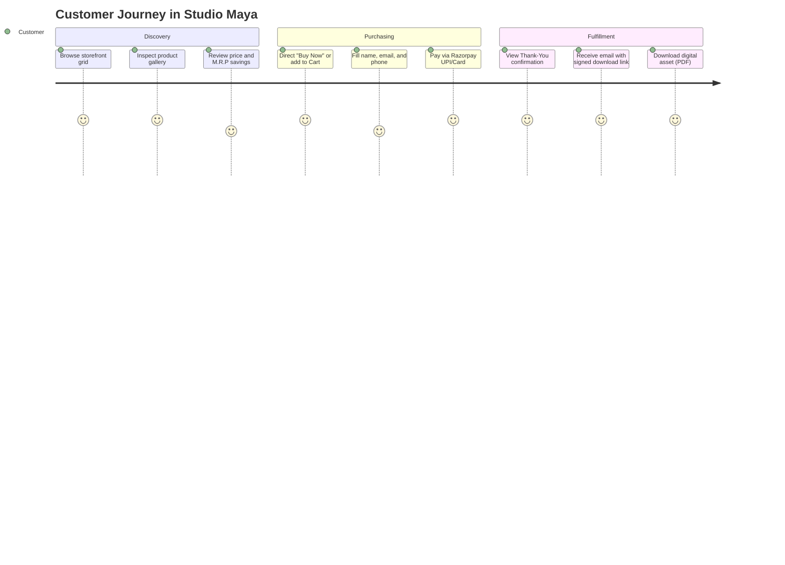
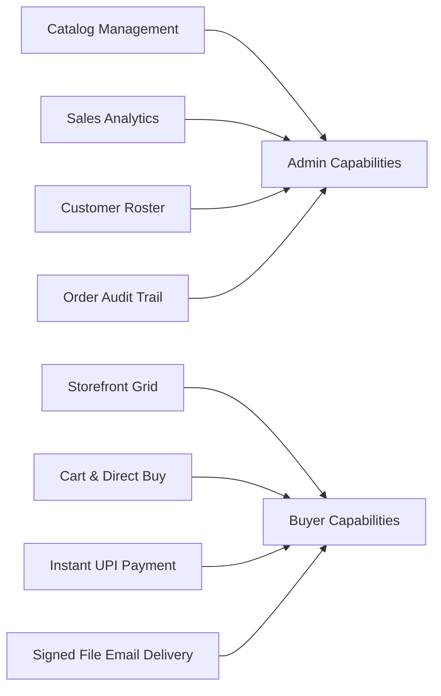

# Product Requirements Document (PRD)
Studio Maya - Modern Digital Product Commerce Platform

> [!NOTE]
> This Product Requirements Document defines the scope, functional specifications, and operational criteria for **Studio Maya**, an e-commerce platform purpose-built for selling high-value digital assets with automated fulfillment.

---

## 1. Executive Summary & Vision

**Studio Maya** is designed to eliminate friction in buying and selling digital products such as Notion templates, operational frameworks, and creative digital assets. Unlike traditional storefronts that impose slow checkouts or heavy commissions, Studio Maya offers an ultra-fast, responsive web interface, instant local UPI/card payment via Razorpay, and guaranteed immediate delivery of digital files via secure signed URLs.

---

## 2. Core Personas & Stakeholders

| Persona | Role | Key Needs & Pain Points | Primary Features Utilized |
| :--- | :--- | :--- | :--- |
| **Digital Shopper** | End User / Buyer | Quick preview, zero account creation barrier, instant delivery, trusted Indian payment methods (UPI, Cards). | Storefront Grid, Product Gallery, Cart Drawer, Razorpay Checkout, Thank-You Page |
| **Store Administrator** | Creator / Merchant | Simple asset uploads, sales analytics, customer list tracking, accurate revenue insights, order audit trail. | Protected Admin Dashboard, Product Manager, Orders Table, Customers Roster |

---

## 3. Functional Specifications

### 3.1 Storefront & Product Discovery
- **Responsive Product Grid**: Dynamic listing of published products with title, category badge, selling price, and optional strikethrough M.R.P.
- **Product Details & Gallery (`/products/[id]`)**:
  - Multi-image image carousel with thumbnail strip.
  - Aspect-ratio preservation (`object-contain`) preventing image distortion across arbitrary dimensions (portrait, landscape, square).
  - Prominent "Buy Now" action and "Add to Cart" capability.
- **Persistent Slide-Out Cart**:
  - Cart drawer accessible from the global navigation bar.
  - Quantity management, item removal, and subtotal calculation stored locally via React Context.

### 3.2 Transaction & Checkout Engine
- **Server-Side Price Integrity**: All transaction amounts are fetched directly from the database using product IDs. Client prices are never trusted.
- **Multi-Item Cart Checkout**: Batch order creation linking individual products to a single Razorpay order.
- **Cryptographic Verification**: Server route handlers verify the HMAC SHA-256 signature using the secret key before order completion.

### 3.3 Fulfillment & Digital Delivery
- **Signed Storage URLs**: Secure 7-day signed download URLs generated for items stored in private Supabase Storage (`product-files`).
- **Transactional Email Dispatch**: Beautifully formatted HTML emails sent through Resend containing direct download buttons and customer support details.

### 3.4 Administrative Control Panel (`/admin/*`)
- **Authentication Guard**: Protected by Next.js Edge Middleware verifying `sb-auth-token` against Supabase Auth and the `admin_users` whitelist table.
- **Dashboard Overview**: Key performance indicators (Total Revenue, Monthly Sales Volume, Top-Selling Products).
- **Product Management**: Create, edit, and archive products with multi-image cover assignment and PDF delivery file uploads.
- **Orders & Customers Tracking**: Real-time view of successful orders with linked buyer records and transaction IDs.

---

## 4. Non-Functional Requirements & Performance SLAs

> [!TIP]
> The platform targets sub-second page loads on standard 4G mobile connections to maximize checkout conversion rates.

- **Performance**: Lighthouse score >= 90 across desktop and mobile. Server Components used for instantaneous data rendering.
- **Upload Constraints**: Strict 2 MB limit per product image and 5 MB limit for delivery PDFs to prevent slow mobile uploads and preserve free-tier storage quotas.
- **Security**: No database credentials exposed to client bundles. Zero client-side price tampering vectors.
- **Reliability**: Graceful error handling for failed transactions or invalid signatures with diagnostic feedback.
