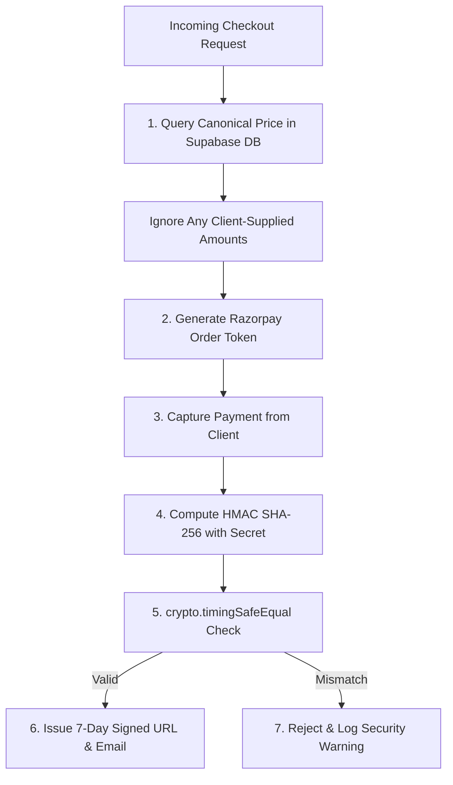
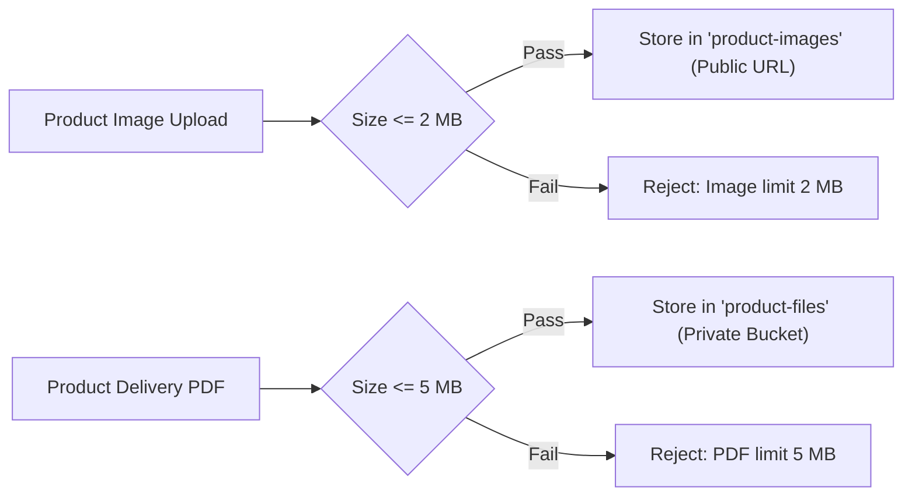

# Engineering Standards & Security Guidelines
Studio Maya - Core Development Rules

> [!IMPORTANT]
> All code contributions, route additions, and infrastructure modifications must adhere strictly to the engineering rules outlined in this specification.

---

## 1. Security Architecture Principles

### 1.1 Zero-Trust Pricing
- **Never Trust Client Prices**: The client provides only `productId` or cart item IDs. The server MUST query the `products` table to fetch canonical pricing before calling Razorpay APIs.
- **Timing-Safe Signature Verification**: Razorpay signatures MUST be verified using `crypto.timingSafeEqual` to eliminate timing attack vectors.

### 1.2 Authentication & Key Separation
- **Dual Supabase Clients**:
  - Use `supabase` (`@/lib/supabase`) initialized with `NEXT_PUBLIC_SUPABASE_ANON_KEY` ONLY for public storefront read queries.
  - Use `createSupabaseAdminClient` (`@/lib/supabaseAdmin`) initialized with `SUPABASE_SERVICE_ROLE_KEY` exclusively inside Server Actions, Route Handlers, and Server Components.
- **Middleware Guard**: Admin paths (`/admin/*`) require valid session verification in `middleware.ts`. Users must exist in the `admin_users` table whitelist.

---

## 2. Coding Standards & Component Architecture

| Standard | Rule | Rationale |
| :--- | :--- | :--- |
| **Component Typing** | Strict TypeScript (`noImplicitAny`) | Eliminates runtime undefined crashes across dynamic route parameters. |
| **Server by Default** | Use React Server Components unless state/events needed | Minimizes client bundle sizes and executes data fetching close to the DB. |
| **Client Boundaries** | Mark files with `'use client'` strictly when using hooks | Clearly isolates interactive logic (like `CartDrawer`, `ProductGallery`). |
| **Error Handling** | Graceful JSON error responses with proper HTTP status codes | Avoids leaking internal stack traces while informing the user. |

---

## 3. Storage & Upload Rules

> [!WARNING]
> Exceeding storage size limits will result in client-side form rejection and server-side action exceptions.

1. **Images**: Max **2 MB** per file. Format: PNG, JPG, WEBP.
2. **Delivery PDFs**: Max **5 MB** per file. Format: PDF.
3. **Next.js Body Limit**: `experimental.serverActions.bodySizeLimit` configured to **10 MB** in `next.config.ts` to accommodate multipart payloads.
4. **Gallery Display**: Visuals must utilize `object-contain` with `max-w-full max-h-full` to preserve natural aspect ratios without cropping or squeezing.
