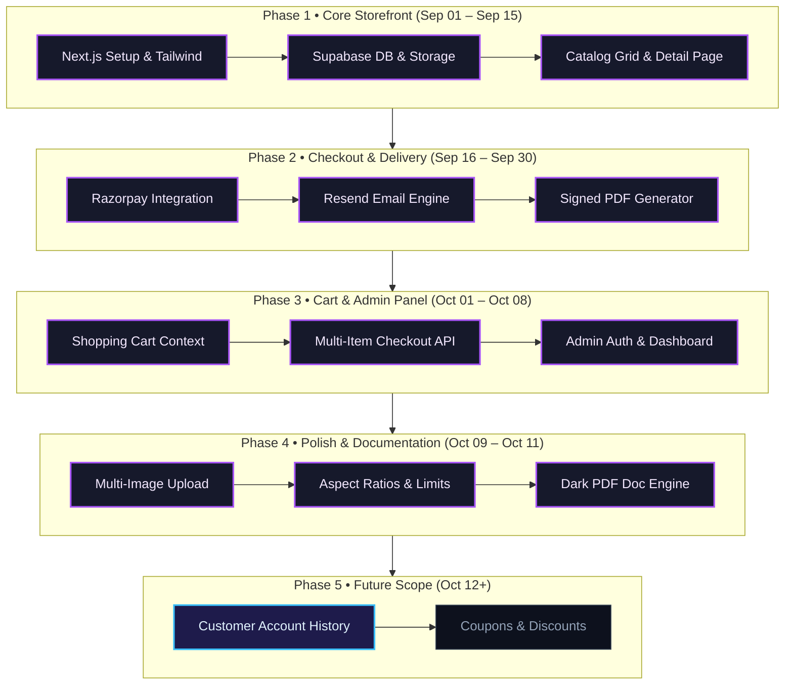

# Engineering Roadmap & Implementation Log
Studio Maya - Digital Commerce Platform

> [!NOTE]
> This tracker outlines completed milestones, active deliverables, and planned architectural enhancements for the Studio Maya project.

---

## 1. Development Timeline & Milestone Overview

### Milestone Timeline Schedule

| Phase | Milestone / Focus | Timeline | Status | Key Deliverables |
| :--- | :--- | :--- | :---: | :--- |
| **Phase 1** | Core Foundation & Storefront | Sep 01 &ndash; Sep 15, 2026 | `DONE` | Next.js 16, Supabase PostgreSQL, Product Grid & Details |
| **Phase 2** | Checkout & Digital Delivery | Sep 16 &ndash; Sep 30, 2026 | `DONE` | Razorpay Direct Buy, Resend Transactional Emails, Signed S3/Storage URLs |
| **Phase 3** | Shopping Cart & Admin Portal | Oct 01 &ndash; Oct 08, 2026 | `DONE` | Persistent Cart State, Multi-Item Checkout API, Admin Auth & Dashboard |
| **Phase 4** | Platform Polish & Engine Docs | Oct 09 &ndash; Oct 11, 2026 | `DONE` | Multi-Image Upload, Aspect Ratio Lock, Headless Markdown-to-PDF Engine |
| **Phase 5** | User Accounts & Promotions | Oct 12 &ndash; Oct 31, 2026 | `ACTIVE` | Customer Purchase History Portal, Promotional Coupon System |

---

## 2. Completed Milestones

### Phase 1: Core Foundation & Storefront
- [x] Initialize Next.js 16 project with App Router and Tailwind CSS.
- [x] Establish Supabase PostgreSQL database schemas (`products`, `orders`, `customers`).
- [x] Configure Supabase Storage buckets (`product-images`, `product-files`).
- [x] Build responsive public storefront grid (`/`) and product details page (`/products/[id]`).

### Phase 2: Payment Gateway & Automated Fulfillment
- [x] Implement direct "Buy Now" Razorpay checkout modal (`CheckoutButton.tsx`).
- [x] Build `/api/create-order` endpoint with canonical price verification.
- [x] Build `/api/verify-payment` endpoint with HMAC-SHA256 signature verification.
- [x] Create 7-day signed download URLs for private digital files.
- [x] Integrate Resend transactional email API for immediate delivery of receipts and download links.

### Phase 3: Shopping Cart & Administrative Suite
- [x] Implement persistent client-side cart state with React Context (`CartContext.tsx`).
- [x] Build animated slide-out Cart Drawer component (`CartDrawer.tsx`).
- [x] Create batch cart checkout endpoint (`/api/cart-checkout`) and batch verification (`/api/verify-cart-payment`).
- [x] Protect administrative routes (`/admin/*`) using Next.js Edge Middleware and `admin_users` table whitelist.
- [x] Build Admin Dashboard overview with sales metrics and monthly performance charts.
- [x] Build Admin Orders page with real-time transaction history.
- [x] Build Admin Customers page tracking unique buyers and purchase frequencies.

### Phase 4: Media Architecture & Documentation System
- [x] Enable multiple product image uploads with cover image reassignment in Add/Edit product views.
- [x] Refactor `ProductGallery.tsx` with `object-contain` to preserve exact aspect ratios for portrait, square, and landscape visuals without cropping or distortion.
- [x] Enforce strict upload limits (max 2 MB per image, max 5 MB for PDF) with client alerts and server checks.
- [x] Configure Next.js Server Action body size limit to 10 MB in `next.config.ts`.
- [x] Implement reusable dark Markdown-to-PDF documentation generator (`scripts/export-pdf.mjs`, `styles/theme.css`, `templates/document.html`).

---

## 3. Active & Upcoming Deliverables

### Phase 5: Future Enhancements
- [ ] **Customer Portal (Optional)**: Magic-link login allowing buyers to access lifetime purchased digital libraries.
- [ ] **Discount Codes & Coupons**: Promotional discounts calculated server-side during checkout.
- [ ] **Automated PDF Stamping**: Dynamically stamp buyer's email onto purchased PDF guides to discourage unauthorized redistribution.
- [ ] **Webhook Backup**: Add Razorpay webhook listener to fulfill orders if user closes browser before client-side verification completes.
