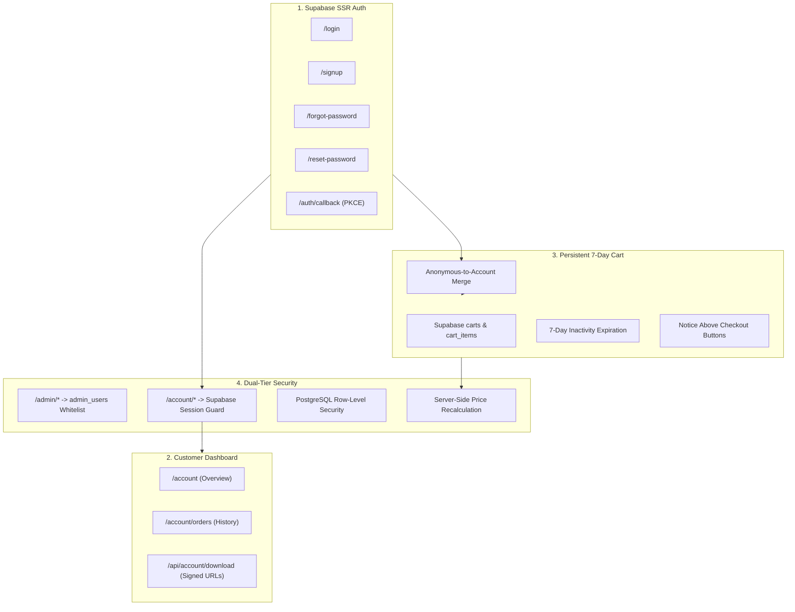
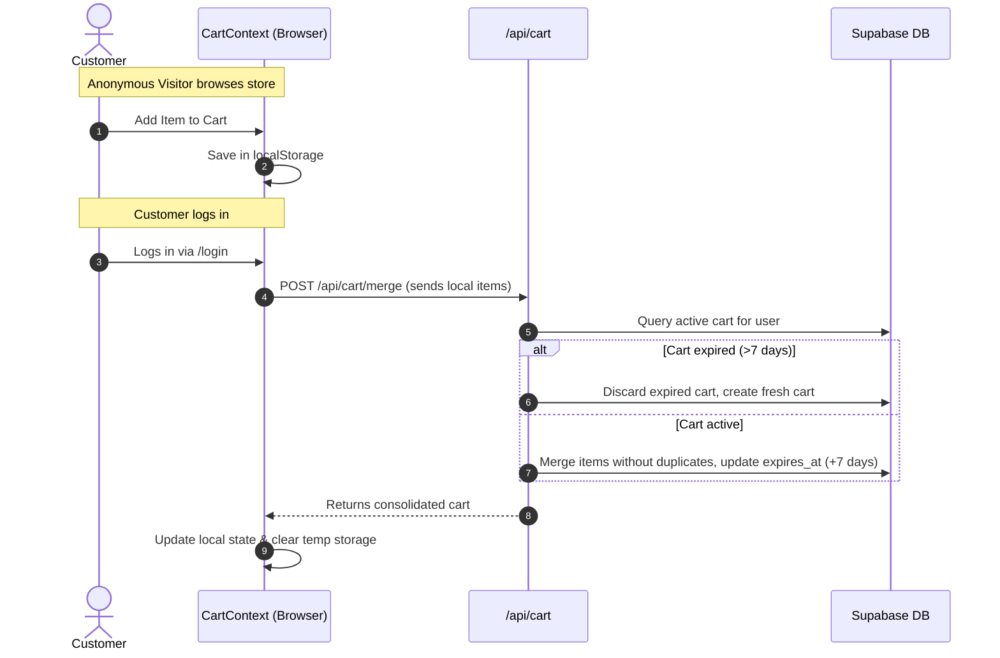
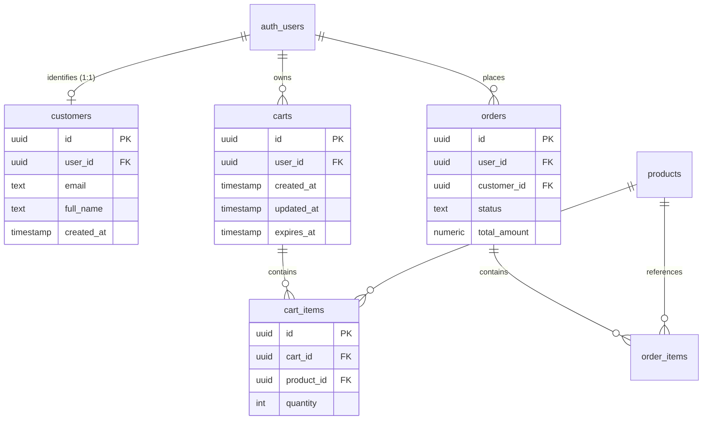

# Studio Maya &mdash; Changelog & System Upgrade Documentation

> [!NOTE]
> This document details the architectural additions, security upgrades, database migrations, and feature implementations introduced to support **Customer Authentication, Account Dashboards, and 7-Day Persistent Shopping Carts** while maintaining existing Razorpay checkouts, Resend email fulfillment, and administrator controls.

---

## 1. Upgrade Summary & Highlights



### Key Milestones:
1. **Supabase Auth via `@supabase/ssr`**: Secure, cookie-based session persistence across client and server environments.
2. **Customer Account Portal**: Dedicated `/account` and `/account/orders` dashboard displaying verified purchase history and time-limited, authorized digital downloads.
3. **Persistent Shopping Cart**: Cross-device cart synchronization for logged-in users with seamless merging of guest carts upon sign-in.
4. **7-Day Expiration Policy**: Inactive carts expire automatically 7 days after last meaningful activity, accompanied by persistent notices displayed directly above all checkout buttons.
5. **Strict Admin & Customer Isolation**: The existing `/admin/*` role system guarded by `admin_users` remains completely isolated from customer accounts.
6. **Zero-Trust Commerce**: Client-submitted totals and prices are never trusted; canonical prices are validated against the database during order creation and payment verification.

---

## 2. Detailed Breakdown of Changes

### 2.1 Dependencies & Configuration

| Package / Config | Type | Description |
| :--- | :--- | :--- |
| `@supabase/ssr` (`^0.12.7`) | Dependency | Added to manage server-side cookies, sessions, and PKCE exchange in Next.js App Router. |
| `package.json` | Script | Configured `next build --webpack` to ensure cross-platform build stability on Windows and Node 24 environments. |
| `eslint.config.mjs` | Linting | Configured Next.js core web vitals and React 19 hook guidelines. |

---

### 2.2 Core Authentication & Server Infrastructure

| File | Purpose | Key Technical Details |
| :--- | :--- | :--- |
| [`lib/supabaseClient.ts`](file:///d:/Notion/digital-store/lib/supabaseClient.ts) | Browser Supabase Client | Singleton instance utilizing `createBrowserClient` from `@supabase/ssr` with anon credentials. |
| [`lib/supabaseServer.ts`](file:///d:/Notion/digital-store/lib/supabaseServer.ts) | Server Supabase Client | Utilizes `createServerClient` reading/writing cookies. Exports `getAuthenticatedUser()` which validates cryptographic JWTs against `supabase.auth.getUser()`. |
| [`lib/customer.ts`](file:///d:/Notion/digital-store/lib/customer.ts) | Customer Record Management | Provides `linkOrCreateCustomer()` to link `auth.users` to the `customers` database table idempotently using stable user IDs without creating duplicates. |
| [`middleware.ts`](file:///d:/Notion/digital-store/middleware.ts) | Dual-Tier Middleware Guard | Protects `/admin/*` via admin token validation against `admin_users`, while protecting `/account/*` via Supabase session validation, redirecting unauthenticated visitors to `/login?next=...`. |

---

### 2.3 Authentication Interfaces & Flows

| Route / File | View / Functionality | Features |
| :--- | :--- | :--- |
| [`app/login/page.tsx`](file:///d:/Notion/digital-store/app/login/page.tsx) | Customer Sign-In | StudioMaya-styled login with email & password fields, show/hide password toggle, "Remember me" session persistence, error alerts, redirect preservation, and conditional Google/Facebook OAuth triggers. |
| [`app/signup/page.tsx`](file:///d:/Notion/digital-store/app/signup/page.tsx) | Customer Registration | Name, email, password, and password confirmation validation with real-time feedback and direct login redirection. |
| [`app/forgot-password/page.tsx`](file:///d:/Notion/digital-store/app/forgot-password/page.tsx) | Password Reset Request | Dispatches Supabase password recovery email with redirect back to the platform callback. |
| [`app/reset-password/page.tsx`](file:///d:/Notion/digital-store/app/reset-password/page.tsx) | New Password Submission | Form for authenticated recovery sessions to update account credentials with confirmation matching. |
| [`app/auth/callback/route.ts`](file:///d:/Notion/digital-store/app/auth/callback/route.ts) | PKCE Code Exchange | Server route exchanging temporary auth codes for active session cookies during email verification and password resets. |
| [`app/api/auth/logout/route.ts`](file:///d:/Notion/digital-store/app/api/auth/logout/route.ts) | Session Termination | Invalidates Supabase sessions server-side and clears authentication cookies. |

---

### 2.4 Customer Account Dashboard & Secure Digital Delivery

| Route / File | Section | Details |
| :--- | :--- | :--- |
| [`app/account/layout.tsx`](file:///d:/Notion/digital-store/app/account/layout.tsx) | Account Layout | Shared authenticated layout with navigation tabs ("Overview" and "My Purchases") and active user context. |
| [`app/account/page.tsx`](file:///d:/Notion/digital-store/app/account/page.tsx) | Account Overview | Displays customer greeting, email, member since date, total order count, recent purchase cards, and quick navigation. |
| [`app/account/orders/page.tsx`](file:///d:/Notion/digital-store/app/account/orders/page.tsx) | Purchase History | Complete paginated list of customer purchases showing Order #, Indian Standard Time date, status badge (Paid, Pending, Failed), total amount, product items, and secure download buttons. |
| [`app/api/account/download/route.ts`](file:///d:/Notion/digital-store/app/api/account/download/route.ts) | Authorized Download API | Enforces ownership check: verifies that the requesting user owns the order and the order status is `paid`. Generates a 7-day short-lived signed URL from Supabase Storage (`product-files`) without exposing service credentials or private storage paths. |

---

### 2.5 Persistent Shopping Cart & 7-Day Inactivity Expiration



| File / Component | Role | Logic & Implementation |
| :--- | :--- | :--- |
| [`lib/cartService.ts`](file:///d:/Notion/digital-store/lib/cartService.ts) | Database Cart Layer | Handles cart querying, item creation/update/deletion, 7-day expiration checks (`isCartExpired`), and anonymous cart merging without duplicates. |
| [`app/api/cart/route.ts`](file:///d:/Notion/digital-store/app/api/cart/route.ts) | Cart Endpoints | `GET` (fetch active cart), `POST` (sync item changes and reset 7-day timer), `DELETE` (clear active cart). |
| [`app/api/cart/merge/route.ts`](file:///d:/Notion/digital-store/app/api/cart/merge/route.ts) | Merge Endpoint | Integrates guest items with database items immediately after login. |
| [`app/api/cart/cleanup/route.ts`](file:///d:/Notion/digital-store/app/api/cart/cleanup/route.ts) | Expiration Cleanup | Scheduled or lazy invocation running `cleanup_expired_carts()` to remove abandoned carts past 7 days. |
| [`components/CartContext.tsx`](file:///d:/Notion/digital-store/components/CartContext.tsx) | Global Cart State | Synchronizes with Supabase DB when user is authenticated, falls back to `localStorage` for guests, triggers merge on auth change, and handles instant quantity updates. |
| [`components/CartDrawer.tsx`](file:///d:/Notion/digital-store/components/CartDrawer.tsx) | Slide-Out Drawer | Added mandatory 7-day cart expiration notice immediately above the "Proceed to Checkout" button. |
| [`app/cart/page.tsx`](file:///d:/Notion/digital-store/app/cart/page.tsx) | Dedicated Cart Page | Full-page cart summary with 7-day expiration notice and direct checkout link. |

#### Expiration Notice Placement:
Displayed immediately above checkout buttons across desktop and mobile viewports:
> *"Your cart is saved for 7 days from your last cart activity. If you don't return within 7 days, your saved cart will expire and its items will need to be added again."*

---

### 2.6 Razorpay Checkout & Webhook Integration

| File | Enhancements | Security & Integrity |
| :--- | :--- | :--- |
| [`app/cart-checkout/page.tsx`](file:///d:/Notion/digital-store/app/cart-checkout/page.tsx) | Customer autofill & notice | Pre-fills name and email for logged-in users; features the 7-day cart expiration banner above the payment button. |
| [`app/api/create-order/route.tsx`](file:///d:/Notion/digital-store/app/api/create-order/route.tsx) | Single-item order creation | Attaches `user_id` / `customer_id` to order records; performs zero-trust database price recalculation with graceful column fallback. |
| [`app/api/cart-checkout/route.tsx`](file:///d:/Notion/digital-store/app/api/cart-checkout/route.tsx) | Multi-item order creation | Recalculates cart item totals on server; generates single order with associated order items linked to customer. |
| [`app/api/verify-payment/route.tsx`](file:///d:/Notion/digital-store/app/api/verify-payment/route.tsx) | Single-item payment verification | Verifies HMAC-SHA256 signature using `crypto.timingSafeEqual`; links customer profile; idempotent against duplicate webhooks; clears active cart on success only. |
| [`app/api/verify-cart-payment/route.tsx`](file:///d:/Notion/digital-store/app/api/verify-cart-payment/route.tsx) | Multi-item payment verification | Verifies signature; persists order items; links customer profile; sends Resend confirmation email; clears user's active cart in Supabase only on verified payment. |

---

### 2.7 Navigation & UI

| Component | Changes |
| :--- | :--- |
| [`components/Navbar.tsx`](file:///d:/Notion/digital-store/components/Navbar.tsx) | Added dynamic auth buttons: "Sign In" and "Sign Up" for guests; interactive user avatar dropdown for logged-in customers featuring "My Account", "My Purchases", and "Log Out". Preserved mobile navigation drawer and active cart badge. |

---

## 3. Database Schema Migration

The migration is documented in:
📄 [`supabase/migrations/20261012_customer_auth_and_cart.sql`](file:///d:/Notion/digital-store/supabase/migrations/20261012_customer_auth_and_cart.sql)

### Summary of Schema Objects:



1. **`customers` Table**: Links `user_id` (`auth.users.id`) with name, email, phone, and metadata.
2. **`carts` Table**: Tracks user cart ID, `updated_at`, and `expires_at` (indexed for 7-day expiration).
3. **`cart_items` Table**: Stores cart items with foreign key references to `carts` and `products`.
4. **`orders` Extensions**: Added `user_id` and `customer_id` columns with non-destructive indexing.
5. **Row Level Security (RLS)**: Enforces strict data ownership so customers can only access their own records.
6. **`cleanup_expired_carts()`**: Stored procedure for safely purging inactive carts older than 7 days without affecting orders or customer accounts.

> [!IMPORTANT]
> **Applying the Migration:**
> The live Supabase database has not been modified automatically. To apply these changes:
> 1. Open the [Supabase Dashboard](https://supabase.com/dashboard).
> 2. Open the **SQL Editor**.
> 3. Paste the contents of [`supabase/migrations/20261012_customer_auth_and_cart.sql`](file:///d:/Notion/digital-store/supabase/migrations/20261012_customer_auth_and_cart.sql).
> 4. Click **Run**.

---

## 4. Test Suite & Verification Results

All unit and integration tests, lint rules, and builds passed:

### Test Suites:
```bash
PASS __tests__/api/account-download.test.ts
PASS __tests__/api/cart-checkout.test.ts
PASS __tests__/api/cart.test.ts
PASS __tests__/api/create-order.test.ts
PASS __tests__/api/verify-payment.test.ts
PASS __tests__/api/verify-cart-payment.test.ts
PASS __tests__/cart-service.test.ts

Test Suites: 7 passed, 7 total
Tests:       19 passed, 19 total
Snapshots:   0 total
```

### Build & Lint:
- **`npm run lint`**: 0 errors, 0 warnings.
- **`npm run build`**: Production build compiled with 0 errors.

---

## 5. Overview & Cart Navigation Enhancements

1. **Account Overview Order Counter & Recent Purchases**:
   - Fixed the query in [`app/account/page.tsx`](file:///d:/Notion/digital-store/app/account/page.tsx) to select existing columns on `orders` and resolve product names dynamically from `order_items`. This resolves the issue where the overview showed 0 purchases and "No purchases yet" even when paid orders existed.
2. **Cart Drawer "Continue Shopping" Navigation**:
   - Updated the "Continue Shopping" action in [`components/CartDrawer.tsx`](file:///d:/Notion/digital-store/components/CartDrawer.tsx) from a state-only toggle to a `<Link href="/">` navigation that closes the drawer and directs the customer back to the storefront home page.
3. **Resilient Order Creation & PostgREST Schema Fallback**:
   - Enhanced the column fallback in [`app/api/create-order/route.tsx`](file:///d:/Notion/digital-store/app/api/create-order/route.tsx), [`app/api/cart-checkout/route.tsx`](file:///d:/Notion/digital-store/app/api/cart-checkout/route.tsx), [`app/api/verify-payment/route.tsx`](file:///d:/Notion/digital-store/app/api/verify-payment/route.tsx), and [`app/api/verify-cart-payment/route.tsx`](file:///d:/Notion/digital-store/app/api/verify-cart-payment/route.tsx) to catch PostgREST `PGRST204` schema cache errors when `user_id` is not yet applied to the remote `orders` table. Order creation and payment verification succeed smoothly without 500 errors.

---

## 6. Standalone Thermal Printer & Product View Upgrades

1. **Standalone Hanging Thermal Printer Machine**:
   - Removed the phone frame/mockup entirely in [`components/DynamicIslandReceipt.tsx`](file:///d:/Notion/digital-store/components/DynamicIslandReceipt.tsx).
   - Designed a standalone hanging thermal printer machine head (`.machine`) with metallic finish, status LED, and feed aperture slot.
   - The thermal receipt feeds out line-block by line-block directly onto the page with realistic stepper feedback.
   - Tapping the sheet triggers the tear-away physics animation with celebration confetti and reveals instant actions (Download, Access in My Purchases, Replay).
2. **Add to Cart in Product View Section**:
   - Added [`components/AddToCartButton.tsx`](file:///d:/Notion/digital-store/components/AddToCartButton.tsx) side-by-side with `CheckoutButton` on [`app/products/[id]/page.tsx`](file:///d:/Notion/digital-store/app/products/[id]/page.tsx).
   - Integrated full [`components/Navbar.tsx`](file:///d:/Notion/digital-store/components/Navbar.tsx) with live cart drawer badge.
3. **Mandatory Sign-In on Buy / Checkout**:
   - Updated [`components/CheckoutButton.tsx`](file:///d:/Notion/digital-store/components/CheckoutButton.tsx): Clicking "Buy Now →" redirects unauthenticated visitors to `/login?next=...` so they sign in before checking out.
   - Updated [`components/CartDrawer.tsx`](file:///d:/Notion/digital-store/components/CartDrawer.tsx) and [`app/cart/page.tsx`](file:///d:/Notion/digital-store/app/cart/page.tsx): Clicking "Proceed to Checkout" redirects unauthenticated users to `/login?next=/cart-checkout`.
   - Updated [`app/cart-checkout/page.tsx`](file:///d:/Notion/digital-store/app/cart-checkout/page.tsx): Unauthenticated direct visits redirect to `/login?next=/cart-checkout`.

---

## 7. Authentic Thermal Email Receipt & Audio Experience Upgrades

1. **Thermal Receipt Transactional Email Template**:
   - Created [`lib/emailReceiptTemplate.ts`](file:///d:/Notion/digital-store/lib/emailReceiptTemplate.ts) with `generateThermalReceiptEmailHtml()` which generates an authentic thermal receipt layout replacing the previous generic confirmation email.
   - Styled to match the physical thermal receipt design (green detached banner, Studio Maya branding, order metadata, item breakdown, dashed dividers, financial summary, barcode, and digital access/download buttons).
   - Integrated into single checkout ([`app/api/verify-payment/route.tsx`](file:///d:/Notion/digital-store/app/api/verify-payment/route.tsx)) and cart checkout ([`app/api/verify-cart-payment/route.tsx`](file:///d:/Notion/digital-store/app/api/verify-cart-payment/route.tsx)).
2. **Audio Enabled by Default**:
   - Initialized `soundEnabled = true` by default in [`components/DynamicIslandReceipt.tsx`](file:///d:/Notion/digital-store/components/DynamicIslandReceipt.tsx).
   - Added user-gesture unlock handlers (global click and touch) to smoothly resume Web Audio `AudioContext` across restrictive mobile and desktop browser autoplay policies.
3. **Real-Life Thermal Printer Audio Synthesis**:
   - Built `playRealLifePrinterSound('line-feed' | 'cutter' | 'tear')` using the browser's native Web Audio API (zero external assets or audio file dependencies):
     - **Line Feed**: Dual-oscillator stepper motor whining (sawtooth + square pulse through resonant lowpass filter) combined with platen roller paper friction noise.
     - **Cutter**: High-frequency metallic blade snap and mechanical guillotine slice.
     - **Tear**: Fibrous white noise burst with rapid decay simulating physical paper tearing.
4. **Butter-Smooth Continuous Paper Feed Animation**:
   - Replaced stepped layout jumps with smooth continuous height transitions using `cubic-bezier(0.2, 0.8, 0.2, 1)`.
   - Content blocks transition opacity smoothly (`transition-opacity duration-300`) as paper advances.

---

## 8. Related Products Section & Order Confirmation Copy Update

1. **Related Products in Product View Page**:
   - Added a "Related Products" recommendation grid in [`app/products/[id]/page.tsx`](file:///d:/Notion/digital-store/app/products/[id]/page.tsx).
   - Intelligently queries published products, prioritizing identical categories and excluding the currently viewed product.
   - Fully interactive cards featuring product thumbnails with hover effects, rating tags, pricing, `AddToCartButton`, and direct product view links.
2. **Order Confirmation Copy Update**:
   - Updated the subtitle text on [`app/thank-you/page.tsx`](file:///d:/Notion/digital-store/app/thank-you/page.tsx) to:
     `"Collect the receipt below. Tap the sheet to tear off your verified pass."`


