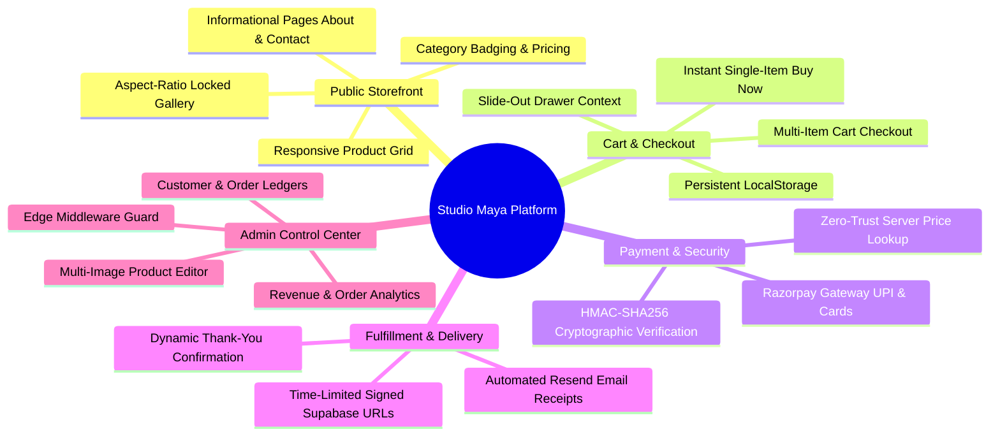
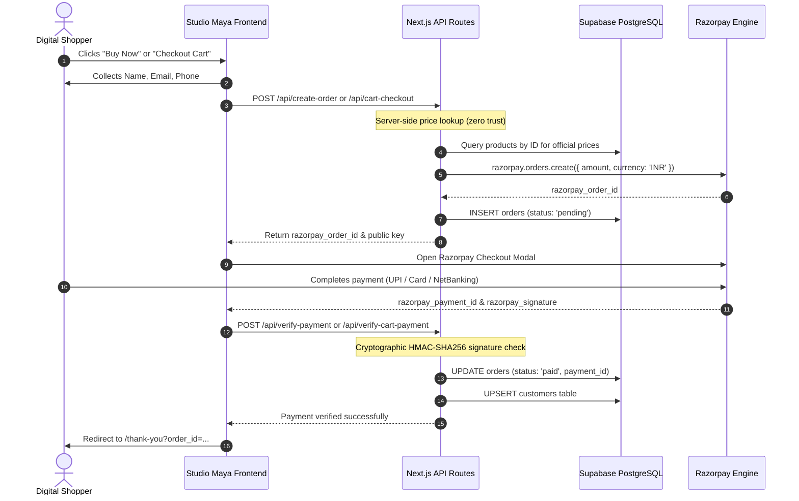
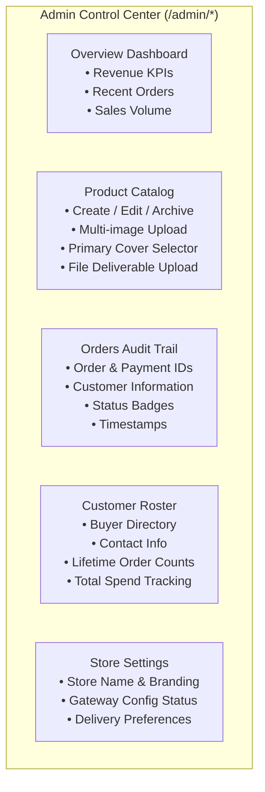
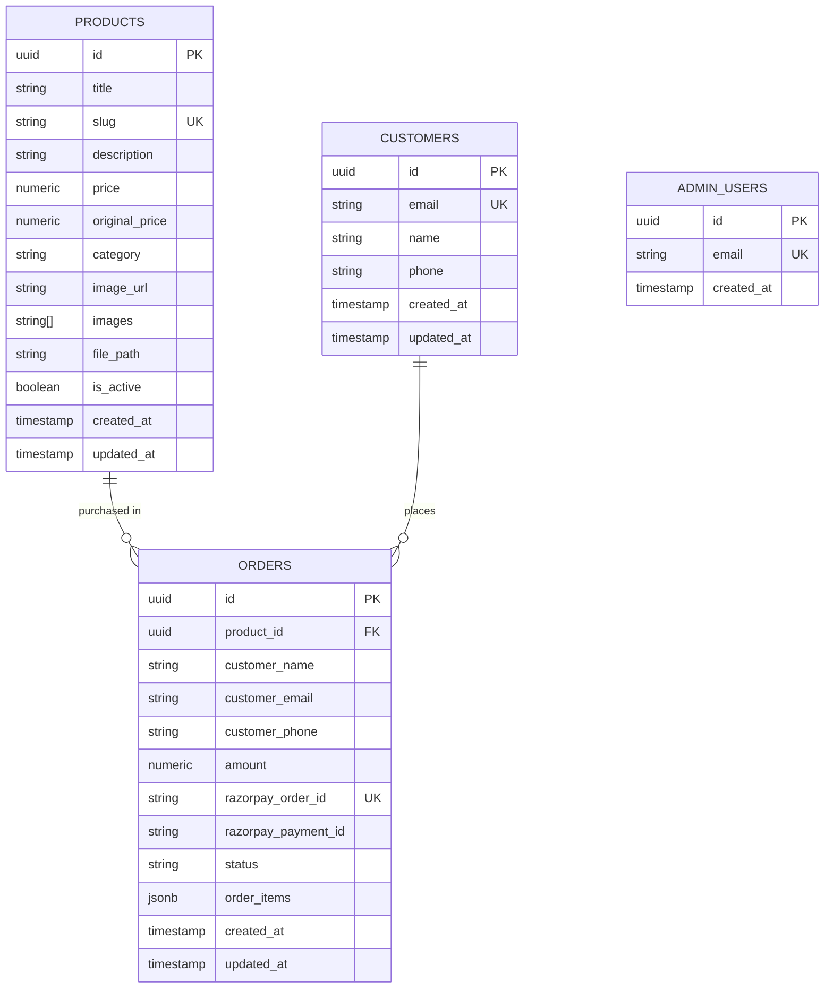

# Studio Maya &mdash; Platform Features & Architecture Explanation

> [!NOTE]
> **Studio Maya** is a modern, full-stack digital commerce platform engineered for creators, designers, and agencies selling high-value digital assets (Notion templates, business frameworks, design systems, and software guides) with automated fulfillment and zero checkout friction.

---

## 1. Executive Overview

Studio Maya bridges the gap between digital content creation and automated e-commerce. Traditional digital storefronts often impose high commissions, rigid designs, and slow customer checkout steps requiring mandatory account creation. Studio Maya eliminates these barriers:

- **Frictionless Buyer Experience**: Instant checkout with no forced account registration. Buyers enter their name, email, and phone number, pay via familiar payment methods (UPI, Cards, Net Banking), and immediately receive their digital downloads.
- **Server-Side Price Integrity**: Zero-trust payment verification where product pricing and cart totals are always queried and verified directly from the database server-side, preventing client-side price tampering.
- **Automated Multi-Channel Fulfillment**: Immediate post-payment access through on-screen secure download links on the Thank-You page, coupled with an instant transactional HTML confirmation email dispatched via Resend.
- **Enterprise-Grade Admin Back-Office**: Role-based administrative dashboard protected by Next.js Edge Middleware and Supabase Auth whitelist validation for managing products, tracking real-time sales revenue, and auditing customer orders.

---

## 2. Comprehensive Feature Breakdown



### 2.1 Public Storefront & Product Discovery

| Feature | Route / Component | Description |
| :--- | :--- | :--- |
| **Responsive Storefront Catalog** | [`app/page.tsx`](file:///d:/Notion/digital-store/app/page.tsx) | Dynamic product grid pulling active products from Supabase PostgreSQL. Renders title, short description, category badge, selling price, and strikethrough M.R.P. savings indicator. |
| **Product Showcase & Detail View** | [`app/products/[id]/page.tsx`](file:///d:/Notion/digital-store/app/products/[id]/page.tsx) | Comprehensive product presentation featuring full Markdown descriptions, feature lists, pricing callouts, delivery specifications, and dual purchase actions. |
| **Aspect-Ratio Preserved Gallery** | [`components/ProductGallery.tsx`](file:///d:/Notion/digital-store/components/ProductGallery.tsx) | Interactive multi-image gallery with thumbnail selector. Uses `object-contain` and letterboxed backdrops to prevent image cropping or distortion across portrait, landscape, and square product assets. |
| **Global Navigation & Brand Bar** | [`components/Navbar.tsx`](file:///d:/Notion/digital-store/components/Navbar.tsx) | Clean sticky navigation bar with brand identity, direct links to Storefront, About, and Contact pages, and an interactive Cart trigger button with real-time item count badges. |
| **Brand Story & Contact Pages** | [`app/about/page.tsx`](file:///d:/Notion/digital-store/app/about/page.tsx), [`app/contact/page.tsx`](file:///d:/Notion/digital-store/app/contact/page.tsx) | Dedicated informational pages detailing Studio Maya's philosophy, design standards, customer support inquiries, and FAQ accordions. |
| **Global Footer** | [`components/Footer.tsx`](file:///d:/Notion/digital-store/components/Footer.tsx) | Standardized footer with copyright notices, social handles, terms, and direct customer support links. |

---

### 2.2 Shopping Cart & State Management

| Feature | Implementation | Description |
| :--- | :--- | :--- |
| **Slide-Out Cart Drawer** | [`components/CartDrawer.tsx`](file:///d:/Notion/digital-store/components/CartDrawer.tsx) | Modern slide-over panel that slides in from the right edge without disrupting the user's current reading or browsing state. |
| **Persistent Cart State** | [`components/CartContext.tsx`](file:///d:/Notion/digital-store/components/CartContext.tsx) | Built on React Context with automatic synchronization to browser `localStorage`. Persists cart contents across page reloads and browser sessions. |
| **Quantity & Item Management** | [`components/CartDrawer.tsx`](file:///d:/Notion/digital-store/components/CartDrawer.tsx) | Allows buyers to increment or decrement quantities, remove individual items, clear the cart, and view real-time subtotal recalculations. |
| **Add to Cart Interaction** | [`components/AddToCartButton.tsx`](file:///d:/Notion/digital-store/components/AddToCartButton.tsx) | Responsive button with loading states, success checks, and optional auto-opening of the drawer upon addition. |
| **Dedicated Cart Checkout Page** | [`app/cart-checkout/page.tsx`](file:///d:/Notion/digital-store/app/cart-checkout/page.tsx) | Full-screen review page providing line-item itemization, subtotal tallies, customer details form, and payment launch trigger. |

---

### 2.3 Payment Processing & Security Engine

Studio Maya implements a robust two-tier transaction architecture supporting both immediate single-item purchases and multi-item cart purchases:



#### Core Security Mechanisms:
1. **Zero-Trust Pricing**: Transaction amounts are **never** passed from or trusted from the client bundle. The server extracts the `productId` or array of `productIds`, queries Supabase directly, calculates the sum, and issues the order with Razorpay.
2. **Cryptographic Signature Verification**: Every transaction response from Razorpay is validated server-side by computing:
   $$\text{HMAC-SHA256}(\text{order\_id} + "|" + \text{payment\_id}, \text{RAZORPAY\_KEY\_SECRET})$$
   Orders are marked as `paid` only when the computed signature strictly matches the signature returned by the gateway.
3. **Customer Record Deduplication**: Upon successful transaction verification, customer name, email, and phone are upserted into the `customers` table to maintain clean customer rosters and order counts.

---

### 2.4 Digital Fulfillment & Delivery Pipeline

Fulfillment is 100% automated, instant, and delivered through redundant channels:

1. **Immediate Thank-You Page (`/thank-you`)**:
   - Confirms order details, transaction ID, customer contact info, and line items.
   - Generates temporary signed download links on the fly, allowing buyers to download their files immediately without leaving the browser.
2. **Secure Time-Limited Signed URLs**:
   - Digital product files (e.g. PDF guides, Notion access keys) are stored in a private Supabase Storage bucket (`product-files`).
   - The server creates time-restricted signed download URLs (valid for 7 days via `supabaseAdmin.storage.from('product-files').createSignedUrl(path, 604800)`).
   - Raw private bucket paths are never exposed directly to public URLs.
3. **Automated Transactional Emails via Resend**:
   - Fires an asynchronous post-verification email to the buyer's email address.
   - Includes custom HTML template with order receipt, product branding, clear download action buttons, and customer support contacts.

---

### 2.5 Role-Based Administrative Control Center (`/admin/*`)



| Admin Section | Path | Key Capabilities |
| :--- | :--- | :--- |
| **Authentication Guard** | [`middleware.ts`](file:///d:/Notion/digital-store/middleware.ts) | Guarded at the Edge. Validates session cookie `sb-auth-token` against Supabase Auth AND confirms user email exists in the `admin_users` table. Non-admins or unauthenticated requests are redirected to `/admin/login`. |
| **Executive Dashboard** | [`app/admin/dashboard/page.tsx`](file:///d:/Notion/digital-store/app/admin/dashboard/page.tsx) | Live summary cards tracking Total Revenue (₹), Total Orders, Total Unique Customers, and Active Product count. Displays real-time recent order activity table. |
| **Product Manager** | [`app/admin/products/page.tsx`](file:///d:/Notion/digital-store/app/admin/products/page.tsx) | Tabular inventory view with title, price, category, status pill (`Active` / `Draft`), and edit/manage shortcuts. |
| **Product Editor & Creator** | [`app/admin/products/new/page.tsx`](file:///d:/Notion/digital-store/app/admin/products/new/page.tsx), [`[id]/edit`](file:///d:/Notion/digital-store/app/admin/products/[id]/edit/page.tsx) | Full management interface: title, slug, price, M.R.P., category, Markdown description, multi-image upload with cover image selection, and delivery PDF upload with client/server size constraints. |
| **Orders Audit Ledger** | [`app/admin/orders/page.tsx`](file:///d:/Notion/digital-store/app/admin/orders/page.tsx) | Audit table displaying all orders, Razorpay payment and order identifiers, customer name and email, amount paid, and status (`paid`, `pending`, `failed`). |
| **Customer Directory** | [`app/admin/customers/page.tsx`](file:///d:/Notion/digital-store/app/admin/customers/page.tsx) | Centralized customer tracking view listing buyer names, emails, phone numbers, and total completed purchases. |
| **System Settings** | [`app/admin/settings/page.tsx`](file:///d:/Notion/digital-store/app/admin/settings/page.tsx) | Store-wide configuration parameters, gateway connectivity check, and administrative preferences. |

---

## 3. Technology Stack Reference

| Layer | Technology | Version | Purpose |
| :--- | :--- | :--- | :--- |
| **Framework** | Next.js (App Router) | `16.3.8` | Server components, edge middleware, dynamic routing, and server actions |
| **UI Library** | React | `19.2.8` | Component rendering, state management, and modern action hooks |
| **Type Safety** | TypeScript | `^5.0` | End-to-end type safety across database schemas, API routes, and components |
| **Styling** | Tailwind CSS | `^4.0` | High-performance CSS utility system with custom dark color palettes |
| **Database** | Supabase (PostgreSQL) | Cloud | Relational tables for products, orders, customers, and admin users |
| **Object Storage** | Supabase Storage | Cloud | Public `product-images` bucket and private `product-files` bucket |
| **Payment Gateway** | Razorpay SDK | `^2.9.8` | Order creation, UPI/Card/NetBanking checkout, and HMAC verification |
| **Email Service** | Resend SDK | `^6.32.0` | Automated transactional emails with signed download buttons |
| **Iconography** | Lucide React | `^1.50.0` | Consistent iconography across navigation, storefront, and admin portal |

---

## 4. Database Schema Architecture



---

## 5. Environment Configuration Guide

To operate Studio Maya locally or in production, configure the following variables in `.env.local`:

```bash
# Razorpay Payment Gateway
NEXT_PUBLIC_RAZORPAY_KEY_ID=rzp_test_...        # Public key passed to the browser checkout modal
RAZORPAY_KEY_SECRET=...                         # Secret key used server-side for HMAC signature verification

# Supabase Database & Auth
NEXT_PUBLIC_SUPABASE_URL=https://...supabase.co # Supabase project URL
NEXT_PUBLIC_SUPABASE_ANON_KEY=eyJ...            # Public anonymous key for client interactions
SUPABASE_SERVICE_ROLE_KEY=eyJ...                # Elevated service role key (SERVER ONLY - never expose to client)

# Resend Transactional Email Engine
RESEND_API_KEY=re_...                           # Resend API key for sending confirmation emails
RESEND_FROM_EMAIL=onboarding@resend.dev         # Verified sender address or domain
```

---

## 6. Development & Operational Commands

| Command | Action |
| :--- | :--- |
| `npm run dev` | Starts the Next.js local development server with Turbopack/Webpack on `http://localhost:3000` |
| `npm run build` | Builds the production bundle and validates TypeScript types and pages |
| `npm run start` | Starts the optimized production server |
| `npm run lint` | Runs ESLint across all codebase files |
| `npm test` | Executes Jest test suites for API routes and checkout logic |
| `node add_admin.js <email>` | Helper script to whitelist an administrator email in the `admin_users` table |
| `node check_data.js` | Diagnostic script to verify database connectivity, products, and orders |
